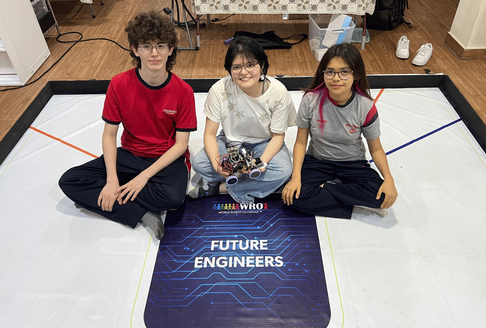
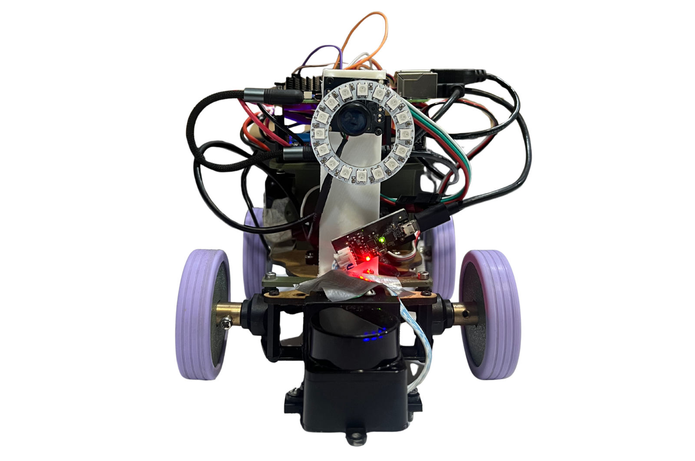
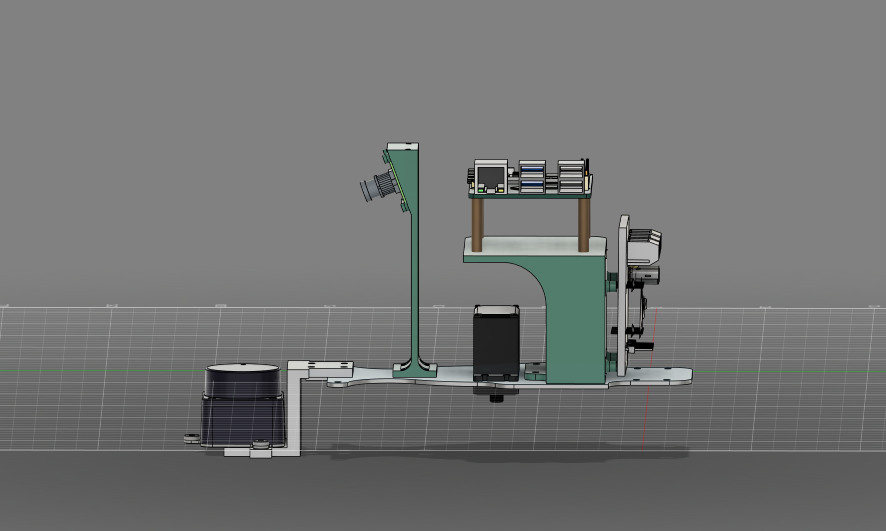
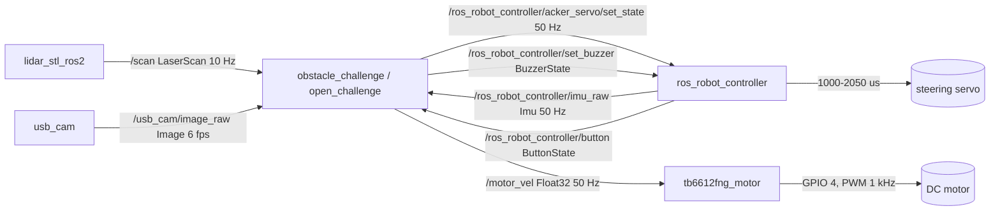
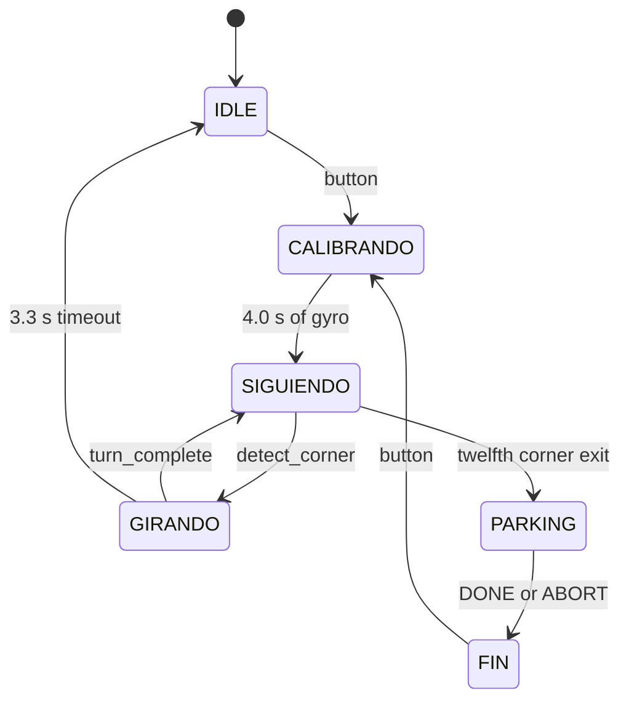
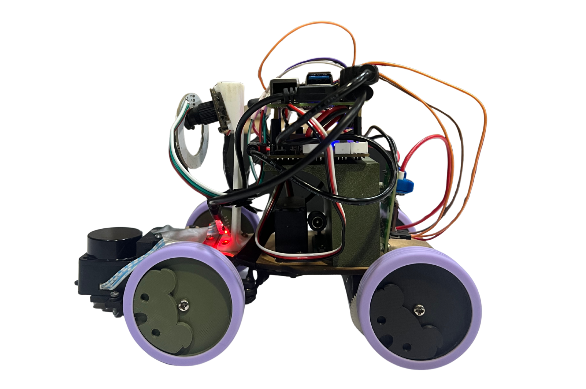
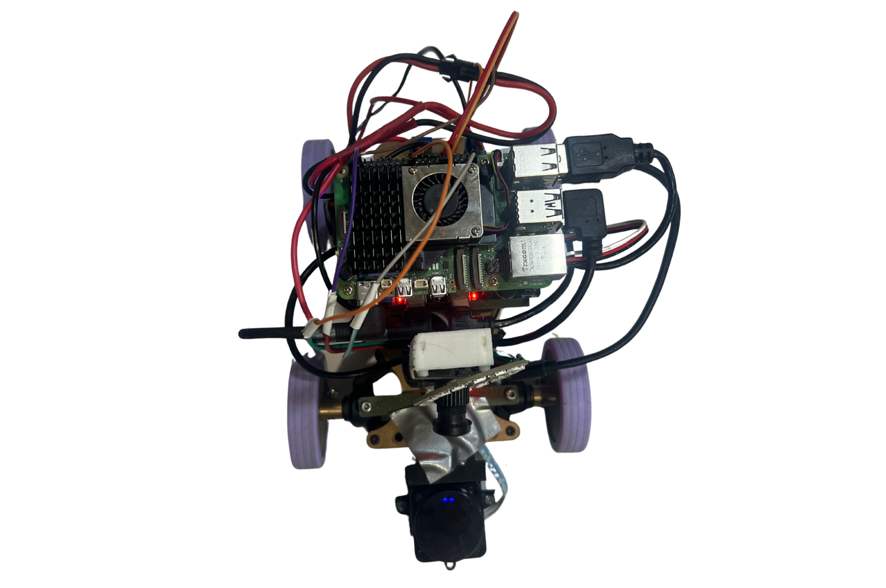
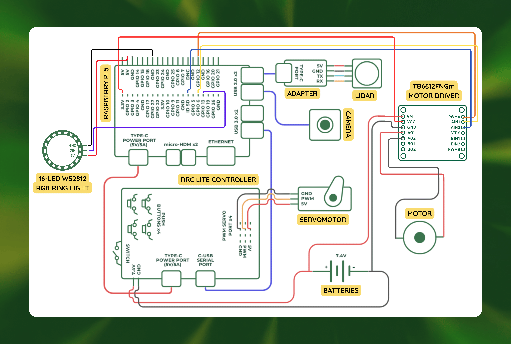
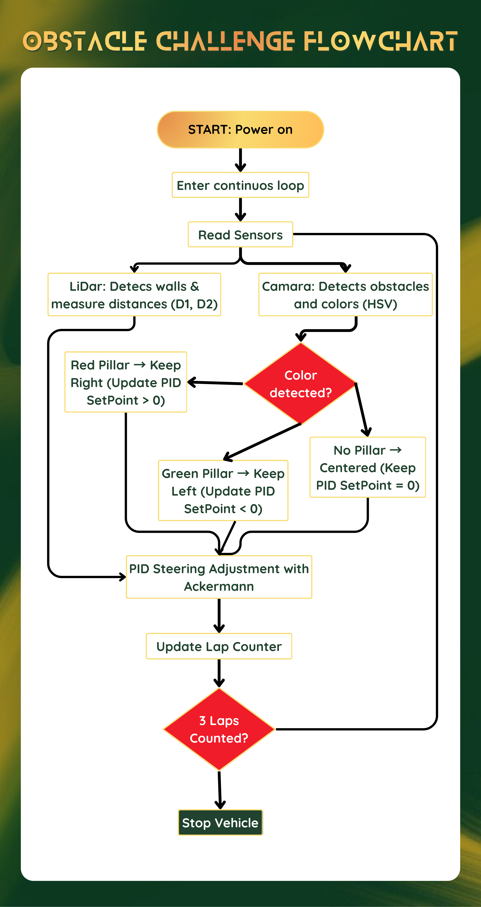

# Renkay: WRO 2026 Future Engineers

Renkay is the Peruvian team for the WRO 2026 Future Engineers category. This repository documents **Sami**, an autonomous Ackermann car that completes three laps of the Open Challenge and three laps of the Obstacle Challenge, then performs a parallel park.

The car runs ROS 2 Jazzy on a Raspberry Pi 5. A 2D LiDAR keeps the car in the lane and finds the corners, a camera reads the red and green pillars, an IMU holds the heading, and a TB6612FNG drives the rear axle. Every design decision, measurement and failed attempt that changed the car is recorded here, including the numbers that are still missing.

| | |
|---|---|
|  |  |
| Renkay at the 2026 season | Sami, vehicle version 11 |

## At a Glance

| Item | Value |
|---|---|
| Team | Renkay, Peru |
| Category | Future Engineers, WRO 2026 |
| Vehicle | Sami, version 11 |
| Dimensions | 189 x 90 mm base plate, 45 mm plate height, 1.39 kg |
| Drive | One 25 mm gear motor, solid rear axle, TB6612FNG |
| Steering | Ackermann, one servo, +/-30 deg command, 0.37 m minimum radius |
| Compute | Raspberry Pi 5, Ubuntu 24.04 arm64 |
| Software | ROS 2 Jazzy, Python 3.12, OpenCV |
| Sensors | LD19 LiDAR, USB camera, IMU on the RRC Lite |
| Power | 7.4 V 5000 mAh 20C Li-Po, 37 Wh, 5 A fuse |
| Open Challenge | Three laps, corner detection from LiDAR geometry, PD heading control |
| Obstacle Challenge | Wall following at 0.18 m, colour side selection, pillar avoidance, parallel park |

## Results

| Test | Result | Evidence |
|---|---|---|
| Three laps, Open Challenge | Completed, under 10 s per lap | [Video](https://youtu.be/lE8SPT6_tL0) |
| Straight-line speed | 0.42 m/s measured at 50 % duty | [`data/measurements.csv`](data/measurements.csv) |
| Steering | 0.37 m minimum radius, 19.7 deg inner wheel at 25 deg command | Circle test, 8 October 2026 |
| Gyro bias | 0.006 rad/s, calibrated for 4.0 s at every start | Stationary log |
| Unit tests | 18 passing without hardware | [`tests/`](tests) |

The Obstacle Challenge video is being recorded; it will show three laps and the parking manoeuvre. The link will replace this paragraph, not a link to another team's run.

## Team

| Member | Role | Responsibility |
|---|---|---|
| Isabella Gonzales | Team member | Team founder, documentation and outreach |
| Rodrigo Osorio | Team member | Software, control and electronics |
| Valeria Hurtado | Team member | Design, manufacturing and testing |
| Anthony Valladolid | Coach | Mechatronics engineer, PUCP |

Contact is through the team Instagram, not personal email addresses.

## Repository Map

| Path | Content |
|---|---|
| [`docs/01-mechanical-design.md`](docs/01-mechanical-design.md) | Chassis, Ackermann geometry, drivetrain, torque, iterations, test log |
| [`docs/02-power-and-sensors.md`](docs/02-power-and-sensors.md) | Power budget, rails, protection, sensor choice, placement, calibration, failure modes |
| [`docs/03-software-architecture.md`](docs/03-software-architecture.md) | Node graph, cascade control, filters, state machines, parking, edge cases, tuning |
| [`docs/04-obstacle-strategy.md`](docs/04-obstacle-strategy.md) | Colour decision, pillar geometry, three-lap sequence, recovery |
| [`docs/05-systems-engineering.md`](docs/05-systems-engineering.md) | Constraints, decision log, iteration log, risk register, verification matrix, cost |
| [`docs/06-repository-and-reproducibility.md`](docs/06-repository-and-reproducibility.md) | Structure, verification order, commit and release policy, licences |
| [`docs/09-media-and-diagrams.md`](docs/09-media-and-diagrams.md) | Every diagram, photograph and video, with the capture protocol |
| [`data/measurements.csv`](data/measurements.csv) | Single source of truth for every number in this documentation |
| [`src/`](src) | ROS 2 packages `renkay_open`, `renkay_obstacle`, `renkay_bringup` |
| [`models/`](models) | Printable parts, STL files and print notes |
| [`schemes/`](schemes) | Wiring, power and software diagrams |
| [`SETUP.md`](SETUP.md) | Build, install, permissions and run instructions |
| [`CHANGELOG.md`](CHANGELOG.md) | Release notes |

## Quick Start

```bash
git clone https://github.com/strvaeq/Robotek-WRO2026.git && cd Robotek-WRO2026
bash tools/setup-pi.sh --check    # inspect only, changes nothing
bash tools/setup-pi.sh            # install ROS 2 Jazzy, udev rules and workspace
source /opt/ros/jazzy/setup.bash
colcon build --symlink-install
source install/setup.bash
python -m pytest tests -q         # 18 tests, no hardware needed
ros2 launch renkay_bringup open.launch.py
```

One launch file at a time: only one node may publish `/motor_vel`. The full procedure, including the HiWonder board packages and the LiDAR driver, is in [`SETUP.md`](SETUP.md).

---


## Mechanical Design

Renkay is a rear-wheel-drive car with front-wheel Ackermann steering, built on a laser-cut MDF base plate with FDM printed housings, wheels and spacers. This is vehicle version 11. The plate is 189 x 90 mm and the mass is 1.39 kg against the 1.5 kg limit, leaving 0.11 kg of margin. The front axle carries the steering linkage, the servo, the LiDAR and the camera; the rear axle carries one motor driving one solid axle through one gear pair. Rules 11.3 and 11.5 forbid differential drive, so the steering geometry, not the motor layout, decides how the car corners.

### Geometry

| Parameter | Value | Source |
|---|---|---|
| Wheelbase | 117.4 +/- 0.2 mm | caliper, `data/measurements.csv` |
| Front track, outer to outer | 133.5 +/- 0.2 mm | caliper, `data/measurements.csv` |
| Rear track, outer to outer | 123.5 +/- 0.2 mm | caliper, `data/measurements.csv` |
| Wheel diameter | 61.0 +/- 0.1 mm | caliper, 3 readings per wheel |
| Wheel width | 14.5 +/- 0.1 mm | caliper |
| Track at steering centres | 119.0 +/- 0.3 mm | front track minus wheel width |
| Wheelbase / front track | 0.88 | derived |
| Chassis plate | 189 x 90 mm | caliper |
| Plate top height | 45.0 +/- 0.5 mm | caliper |
| Ground clearance | pending measurement | not measured |
| CG height | pending measurement | balance test not run |

The 133.5 mm front track is outer to outer, which is how a judge with a caliper checks the 200 mm width limit. The track at the steering centres is 133.5 - 14.5 = 119.0 mm, and that is the value the steering formula uses; the outer-to-outer figure would overstate the required differential by 12 %. The front track is 10.0 mm wider than the rear so the hubs clear the plate, which makes the front outer wheel the widest point of the car.

### Why Ackermann

Two front wheels on one axle cannot both aim at the turn centre, so the inner wheel turns further than the outer:

```
cot(delta_outer) - cot(delta_inner) = t / L
R = L / tan(delta)
```

At a 25 deg command the circle test of 8 Oct 2026 measured 19.7 deg on the inner wheel turning left and 17.6 deg turning right. The tighter case gives `R_min = 117.4 / tan(17.6) = 370 mm`, so 0.37 +/- 0.03 m. The outer front wheel centre runs at `R + t/2 = 430 mm`, a 505 mm swept band, which leaves 95 mm in the 600 mm corridor. Differential drive is forbidden by rules 11.3 and 11.5 and omni wheels and casters by 11.4, so skid steer is a disqualification before it is a performance question; it would also scrub and invalidate the rear encoder as a speed signal. The linkage, four pivots and a servo inside a 90 mm plate are the price of the geometry.

### Drivetrain and Torque

One 25 mm metal gear motor drives the rear axle through one gear pair, and both rear wheels share a solid axle. The driver is a TB6612FNG switching at 1 kHz. Speed follows `v = 0.0137 x (duty - 6.5) m/s`, fitted on 1 s pulses at 7.3 V, so 35 % duty is 0.39 m/s, the lowest usable cruise, and the measured top speed is 0.42 m/s at 50 % duty, 30 % below the model, which is not extrapolated above 35 %. The axle needs `T = m x a x R_wheel = 1.39 x 1.0 x 0.0305 = 0.042 N m` to hold the 1.0 m/s^2 limit. Motor shaft torque and stall torque are pending measurement.

### Iterations that Changed Performance

| Version | Change | Reason | Measured effect |
|---|---|---|---|
| [v8](v-photos/vehicle-versions/README.md) | Vertical servo with the output down, slimmer printed front wheels, tilted LiDAR bracket | A horizontal servo cost height and limited swing; HiWonder wheels widened the car | Wider servo swing was the intent; the angle gain itself is not measured |
| [v9](v-photos/vehicle-versions/README.md) | Ackermann moved a few millimetres, wheel grooves, printed cylinders between the wheels | The rack collided with the servo in v8; screws touched the tyre | 20 s per lap |
| [v10](v-photos/vehicle-versions/README.md) | Big gear on the motor shaft, all four wheels printed | Same motor, more speed at the axle | 3 laps in 28 s, under 10 s per lap |
| [v11](v-photos/vehicle-versions/README.md) | LiDAR at 30 mm in a front housing, TB6612FNG driver, 5000 mAh pack, 16 LED ring | LiDAR looked over the 100 mm wall; the L298N stalled below 50 % duty | Holds from 35 % duty; plane 70 mm below the wall top; 37 Wh gives 2.3 h nominal |



*Figure 1. Vehicle version 11 rendered from the CAD, left side. The LiDAR housing sits at the front below plate level, the camera on the inclined front mount, and the battery, Pi 5 and driver stack over the rear axle.*

The car is a laser-cut MDF base plate, four printed wheels, printed housings for the LiDAR, the camera and the Pi with the battery and driver, plus printed spacers and purchased rubber bands. The plate is cut rather than printed because a 189 x 90 mm printed plate warps and loses hole positions; it was prototyped in cardboard and acrylic, then cut from Fusion 360. The wheels are printed because HiWonder wheels were wider than the 200 mm parking slot tolerates, and they carry rubber bands because without a friction border the car could not move at all.

The vertical servo of v8 is what put the steering angle behind the 0.37 m radius; the v9 repositioning removed a hard failure, because the v8 rack collided with the servo. The 11 % radius asymmetry survived both and is compensated in the servo gains.

Geometry, manufacturing, assembly and the full test log are in [docs/01-mechanical-design.md](docs/01-mechanical-design.md), which also lists what is still unmeasured and why.

## Power and Sensors

The car runs on a 7.4 V 5000 mAh 20C Li-Po, 37 Wh, fused at 5 A and split into two rails: a 5 V rail from the RRC Lite for the servo, IMU, Pi 5 and LED ring, and the pack rail into a TB6612FNG for the motor. The motor branch is chopped at 1 kHz and carries no linear regulator; the 5 V branch carries everything that cannot take 8.4 V. The split is what keeps motor noise out of the Pi supply, and the servo is on the RRC Lite, not on the Pi header.

### Power Budget

| Load | Rail | Typical | Peak |
|---|---|---:|---:|
| Raspberry Pi 5 | 5 V | 0.60 A | 2.50 A |
| LD19 LiDAR | 5 V | 0.25 A | 0.35 A |
| USB camera | 5 V | 0.20 A | 0.25 A |
| Steering servo | 5 V | 0.25 A | 2.00 A |
| Drive motor | 7.4 V | pending | 3.20 A |
| RRC Lite | 5 V | 0.12 A | 0.20 A |

The derived 5 V total of 1.72 A also includes the 0.30 A LED ring. Measured currents are pending: no clamp meter reading exists for the 5 V rail or the motor branch, so the motor typical is a 0.40 A allowance used only for the autonomy figure. Peaks are datasheet values, and the 3.20 A motor peak is the TB6612 limit rather than a motor measurement. Source: `data/power-budget.csv`. Nominal draw is 12.73 W, which gives 2.3 h from 80 % of the pack; a 3 min round needs 2.2 % of that energy, so wire rating and sag, not capacity, set the limit.

### Sensor Suite

| Sensor | Range | Rate | Why chosen | Failure mode |
|---|---|---|---|---|
| LD19 LiDAR | 0.03 to 12 m | 10 Hz, 360 deg | Distance at a known bearing and the wall angle; 500 samples per revolution, 0.72 deg apart | Dark or angled surfaces, 30 mm blind zone, returns from the car body |
| USB camera | 0.28 m to horizon | 6 fps, 66.7 deg horizontal | Colour only; a 50 x 100 mm sign is 670 px wide at 1.5 m, above the 650 px threshold | Glare, occlusion, motion blur |
| RRC Lite IMU | n/a | 50 Hz | Yaw rate for the steering loop at the 60 ms servo delay | Drift, vibration, axis remap |

The LiDAR wins on geometry and the camera wins on colour, so neither is redundant. Ultrasonic and ToF sensors were rejected because they give a range but no bearing; a depth camera was rejected because the LiDAR already supplies geometry at a fraction of the cost.

### Placement

The LiDAR scan axis sits 128 mm ahead of the rear axle and its plane 30 mm above the ground, inside the 0 to 100 mm wall height, so a level beam cannot pass over a wall at 0.18 m. At the 1.0 m/s^2 limit the car pitches 5.8 deg, raising the beam 18 mm there and still leaving 52 mm to the top. The camera sits 56.5 mm ahead. The LiDAR nose reaches 147.7 mm and is the front contact point: a wall or pillar touches the polycarbonate tab before the plate or the lens, protecting the scan plane and giving a predictable contact for the 85 mm pillar rule.

### Wiring and Calibration

The pack feeds a 5 A fuse 30 mm from the XT60, then a switch; 7.4 V goes to the TB6612 VM, and 5 V from the RRC Lite to the Pi header, servo and LED ring, with camera and LiDAR on Pi USB. Ground is a star at the RRC Lite. Gyro bias is averaged over 4.0 s stationary at each start, accepted within +/-0.02 rad/s against a measured +0.006 rad/s. The servo centre is commanded at 1500 us, wheels off the ground, accepted at 0.0 +/- 0.5 deg and parallel within 0.5 deg.

The pin-level drawing is [schemes/electrical-wiring-diagram.png](schemes/electrical-wiring-diagram.png); the assembly view is `schemes/visual-wiring-diagram.png`, and `schemes/power-distribution-diagram.png` is the superseded v10 drawing. Connectors are an XT60 on the pack, a 5 A blade fuse in the pack positive, ferrules on the TB6612 terminals, a 3-pin JR lead on the servo and Dupont on the four GPIO signals. Full budget, protection, bus map, calibration procedures and failure modes are in [docs/02-power-and-sensors.md](docs/02-power-and-sensors.md).

## Software Architecture

The car runs ROS 2 Jazzy on a Raspberry Pi 5 with two Python packages, `src/renkay_open` and `src/renkay_obstacle`. Each
has one node, `open_challenge` and `obstacle_challenge`, and one entry point, `robot_node.py`: it reads every sensor, runs
the state machine and writes the servo and the motor. Control is a cascade, the LiDAR sets the heading to hold, the IMU
holds it, and the inner loop closes every 20 ms. `config.py`, `control.py`, `color_vision.py` and `parking.py` import no
`rclpy` and own no topic, so every filter and control law runs on a laptop.

### Node Graph



All of it runs on the Pi 5 except the servo, IMU, button and buzzer, which sit on the RRC Lite MCU and reach the Pi as
microseconds over one USB link.

### Control Loop

Only the inner loop writes the servo. The outer loop runs on `/scan` at 10 Hz and turns geometry into a heading request:
Open centres the corridor with `OuterLoop` (`KP_OUT` 27 deg/m, `KD_OUT` 4.5, filtered derivative, request clamped to
±9 deg), Obstacle holds the wall with `wall_follow_offset`, `atan(1.5 * (distance - 0.18))` clamped to ±7 deg. The inner
loop runs on the IMU at 50 Hz, `delta = KP_IN * err - KD_IN * gz`, and the servo is written every 20 ms as 1000 to
2050 us. Gains are Open `KP_IN` 1.6 and `KD_IN` 0.28, Obstacle 1.8 and 0.22. There is no integral term: the plant already
integrates heading into lateral position, the outer loop removes the steady state error, it is frozen during a turn so it
cannot wind up, and the ±30 deg clamp is active in every tight corner. The derivative acts on the gyro, not on the error.

### Perception

`window_median` sorts 29 bins, ±10 deg at 0.72 deg per bin, and returns the middle one. Median, not mean: with 5 rays on
a 50 mm pillar at 0.40 m among 24 on the wall at 0.18 m the mean reads 0.218 m and the median stays 0.180 m, and
non-finite or out-of-range returns are dropped before the sort. Indices come from the message,
`round((theta - angle_min) / angle_increment) mod N`, because the scan is 306 bins over 220 deg, so 180 deg is bin 152.
Vision blurs 5x5, converts to HSV, masks red in two hue ranges and green in one, opens and closes 7x7, filters area, fill
and aspect, and keeps the largest `base_norm`; a colour needs 3 frames and a block expires 1.5 s after the last detection.
The frame is used as captured, no rotation: the inverted mount mirrors the lateral coordinate.

### State Machines

Open Challenge (`src/renkay_open/renkay_open/robot_node.py`):

| State | Purpose | Exit condition |
|---|---|---|
| `IDLE` | powered, motor 0, servo centred | button state 1 or 5, 1.5 s debounce |
| `CALIBRANDO` | average the gyro for 4.0 s as the bias | `GYRO_CAL_S` elapsed, bias applied |
| `RECTO` | centre the corridor at 75 % duty, watch for corners | `detect_corner`: front < 0.80 m, a side > 1.80 m, heading within 10 deg |
| `GIRANDO` | turn to the new base at 42 % duty | within 4 deg of the base and yaw rate < 20 deg/s; 3.3 s timeout stops the car |
| `FIN` | 0 % duty, two beeps, `MAX_LAPS` reached | button edge |

Obstacle Challenge (`src/renkay_obstacle/renkay_obstacle/robot_node.py`):

| State | Purpose | Exit condition |
|---|---|---|
| `IDLE` | powered, motor 0, servo centred | button state 1 or 5, 1.5 s debounce |
| `CALIBRANDO` | average the gyro for 4.0 s as the bias | `GYRO_CAL_S` elapsed, bias applied |
| `SIGUIENDO` | follow the wall at 0.18 m, add the pillar nudge, apply the colour side | `detect_corner`: front < 0.65 m, a side > 1.20 m, heading within 15 deg |
| `GIRANDO` | hold 35 % duty through the 90 deg arc | within 4 deg of the base and yaw rate < 20 deg/s |
| `PARKING` | hand the servo to `ParallelPark` | `ParkState.DONE` or `ParkState.ABORT` |
| `FIN` | 0 % duty, two beeps on success, one long on abort | button edge |

A lap is counted on confirmed corner exits (`LapCounter`), four corners per lap, and `MAX_LAPS = 3` sends the twelfth
corner exit into `PARKING` instead of the next straight. The corner guard is four conditions in series: front clearance, a
1.5 s cooldown, a settled heading and one open flank; the direction is fixed at the first corner and kept for the round.
Gain derivation, phase margin, edge cases and the performance budget are in
[`docs/03-software-architecture.md`](docs/03-software-architecture.md).

## Obstacle Strategy

Three laps with red and green pillars, then a parallel park. The car holds one wall at 0.18 m and turns 90 deg at each of
four corners; the colour of the last confirmed pillar decides which wall, so the pillar passes on the side the rule
requires with no waypoint and no map.

### Colour Decision

| Colour seen | Wall to follow | Steering response | Return condition |
|---|---|---|---|
| red, 3 frames, not turning | right (`wall_side = 'right'`) | right wall at 0.18 m, pillar passes on its left | block leaves the near zone or expires, wall unchanged |
| green, 3 frames, not turning | left | left wall at 0.18 m, pillar passes on its right | block leaves the near zone or expires, wall unchanged |
| none yet | right by default | same as red, a valid line for a round with no pillars | next confirmed colour |
| any colour, while `GIRANDO` | unchanged for this corner | nudge only, no side change | side applied after the turn completes |
| red then green, or the reverse | new side, heading re-anchored | `reanchor_heading`: base = measured heading, `theta_ref` = 0 | next corner |

### Pillar Avoidance

The car never steers at a pillar; it keeps the wall and adds a heading bias while the block is near. `detect_block`
returns `(colour, cx_norm, base_norm, area)` for the block with the largest `base_norm`, and `pillar_nudge_deg` stays zero
until `base_norm >= 0.5`, then commands `clamp(-cx_norm * 14, -12, 12)` deg. The bias is added to the wall request and
the sum is clamped to ±(7 + 12) deg, so the wall target stays 0.18 m and the follower pulls back once the bias is removed.
A pillar cannot pass for a wall twice: `estimate_wall` rejects any fit that jumps more than 0.35 m (`WALL_JUMP_MAX_M`)
from the previous distance. When the colour flips the side, `reanchor_heading` sets the heading base to the measured
heading, zeroes `theta_ref` and forgets `wall_dist`, so the gate restarts against the new wall.

### Parallel Parking

The bay is 20 cm wide and the slot is 0.60 m long (`PARK_SLOT_LEN_M`). `ParallelPark` in `parking.py` runs
`APPROACH -> ALIGN -> REVERSE_ARC -> STRAIGHTEN -> DONE`, with `ABORT` reachable from any state, driven by the IMU heading
and the side, front and rear ranges (the rear ray is read only here). `APPROACH` creeps at 12 percent until the rear range
falls to 0.60 m and the slot is beside the car. `ALIGN` straightens with `clamp(-yaw, ±30)` deg until `|yaw|` is within
2 deg. `REVERSE_ARC` reverses at 25 percent on full lock, `PARK_STEER_SIGN * DELTA_MAX_DEG`, until the heading has swept
45 deg (`ARC_YAW_DEG`). `STRAIGHTEN` reverses straight until the side range reaches the 0.15 m gap (`PARK_TARGET_GAP_M`).
Abort rules: a front range under 0.10 m at any time, or 8.0 s elapsed (`PARK_MAX_TIME_S`); a rear range under 0.05 m ends
the manoeuvre as `DONE`. The manoeuvre is implemented, its success rate is measured on the field, no run is logged yet.

| State | Action | Exit condition |
|---|---|---|
| `APPROACH` | 12 % forward, rear range watched | rear range <= 0.60 m |
| `ALIGN` | 8 % forward, steer `clamp(-yaw, ±30)` deg | `|yaw| <= 2` deg |
| `REVERSE_ARC` | reverse 25 %, full lock `PARK_STEER_SIGN * 30` deg | heading swept 45 deg |
| `STRAIGHTEN` | reverse 25 %, servo centred | side range <= 0.15 m, or rear <= 0.05 m |
| `DONE` | 0 %, servo centred | terminal |
| `ABORT` | 0 %, one long beep | front < 0.10 m or 8.0 s elapsed |



The colour table, the clearance geometry, the failure recovery table and the full three lap sequence are in
[`docs/04-obstacle-strategy.md`](docs/04-obstacle-strategy.md).

## Systems Engineering

### Constraints

| Constraint | Value | Consequence |
|---|---|---|
| Lane width | 1 m | The 300 x 200 mm rule envelope leaves 0.37 m turning radius and room to correct; no skid steering |
| Wall height | 10 cm | LiDAR plane sits at 30 mm and 128 mm ahead, so the beam returns from the wall, not over it |
| Three laps per round | 3 laps | Lap count comes from confirmed corner events, with a finish beep on the third |
| Parking bay | 20 cm | Parking is a reverse arc with a 0.15 m target and an abort below 0.10 m front clearance |
| No external compute | 0 off-board processes | Every node runs on the Pi 5; no laptop, no Wi-Fi link in the control loop |
| Supply | 7.4 V | 2S Li-Po feeds the motors through the TB6612FNG, the RRC Lite makes the 5 V rail |
| Parking budget | 8 s | The four parking phases share one time limit and the node stops on expiry |
| Team | 3 members | One owner per subsystem: power, software, mechanics and vision |
| Build window | 6 weeks | One chassis concept, no second prototype; changes go into the running car |

### Key Decisions

| Decision | Alternative rejected | Evidence |
|---|---|---|
| TB6612FNG motor driver | L298N | v10 stalled below 50 % duty on the Darlington drop; 35 % now gives 0.39 m/s, deadband 6.5 %, reverse works |
| 5000 mAh pack | 2000 mAh pack | Energy rises 150 % to 37 Wh; the extra 0.10 kg costs 0.003 N m of the 0.042 N m available |
| Polycarbonate parts | PLA parts | PLA housings near the servo and pack deformed; PC holds shape, PLA is kept for fit checks only |
| PD heading control | PID | No integral means no windup during the 1.5 s corner cooldown; D acts on gyro rate, gains 1.8/0.22 and 1.6/0.28 |
| Median wall distance | Mean wall distance | One pillar ray skews a mean by tens of cm; a 29-ray median over 10 deg tolerates 14 bad rays |
| LiDAR low, front mounted | LiDAR high on top | On top the plane sat above the 100 mm walls; at 30 mm it keeps a 70 mm margin and a valid line in corners |

### Risks

| Risk | Detection | Mitigation |
|---|---|---|
| Brownout on start | Pi undervoltage flag, power status | Separate motor path, 1.0 m/s^2 ramp, 5000 mAh pack |
| LiDAR dropout | `/scan` timeout at 0.35 s | Watchdog latches a stop; the last value is never reused |
| Camera glare or false colour | Decision log, confirmation counter | LED ring, dual red HSV range, 3-frame confirmation, area and fill filters |
| Servo stall at the stop | Yaw not following for 0.5 s | 30 deg clamp, 1000 to 2050 us pulse clamp, asymmetric gains |
| Lap miscount | Lap and finish beeps, corner counter | Corner events confirmed by yaw, 1.5 s cooldown, 10 deg margin |

Every constraint above has a source, every decision a reversal trigger, and every risk an owner. The full registers, the 11-version iteration log, the verification matrix and the honest measurement gaps are in [Systems Engineering](docs/05-systems-engineering.md).

## Reproducibility

Another team can rebuild this vehicle from this repository: the parts list, the pin map, the udev rules, the parameter files and the measurements are all committed, and nothing in the build depends on a file stored outside the repository. The target is Ubuntu 24.04 arm64 on a Raspberry Pi 5 with ROS 2 Jazzy and Python 3.12.

### Build and Run

```bash
git clone https://github.com/strvaeq/Robotek-WRO2026.git && cd Robotek-WRO2026
bash tools/setup-pi.sh
source /opt/ros/jazzy/setup.bash
colcon build --symlink-install
source install/setup.bash
ros2 launch renkay_bringup open.launch.py
ros2 launch renkay_bringup obstacle.launch.py
```

The setup script installs ROS 2 Jazzy, the Debian packages, the udev rules and the workspace; `--check` only inspects, `--dry-run` prints the commands. Run one launch file at a time, because only one controller may publish `/motor_vel`. The HiWonder board packages and the LD19 driver live in a separate workspace built before `colcon build`, as described in `SETUP.md`.

### Tests

The repository has 18 unit tests that run without ROS, without a camera and without GPIO, so a reader can check the logic on any laptop. They cover the median wall filter and its rejection of pillar returns, the wall estimate, lap counting from confirmed corner exits, the signed duty mapping that makes reverse possible, the scan angle conversion from `angle_min`, and the parking state machine including both abort paths and reset. The same suite runs on every push and pull request in [`.github/workflows/tests.yml`](.github/workflows/tests.yml), which also fails if a link in this README or in `docs/` points at a missing file. Locally:

```bash
python -m pytest tests -q
```

### Releases and History

Releases follow semantic versioning, and each tag has a `CHANGELOG.md` entry and release notes that name the vehicle design version. The current release is `v1.0.0` of 4 November 2026, the car that ran the season. The history satisfies the 2026 three-commit rule: the first commit is dated no later than two months before the competition, the second no later than one month, and the third no later than two weeks, and the third is the one mainly evaluated. The history is recorded in the repository and is not rewritten.

### Repository Policy

- The code is released under the MIT license in [`LICENSE`](LICENSE), so it can be reused with attribution.
- The repository is public from submission and stays public for at least twelve months after the event.
- No third-party assets are used: every diagram, photograph and video is produced by the team and stored in this repository.

The step-by-step build, the device permissions and the troubleshooting table are in [`SETUP.md`](SETUP.md); the structure, the verification order and the commit policy are in [Repository and Reproducibility](docs/06-repository-and-reproducibility.md).

## Media

| Challenge | Link | Status |
|---|---|---|
| Open Challenge | https://youtu.be/lE8SPT6_tL0 | Published, autonomous run |
| Obstacle Challenge | To be published before the event | Pending: three laps and the parking manoeuvre |

| | |
|---|---|
| <br>Vehicle, left view | <br>Vehicle, top view |
| <br>Electrical wiring, 7.4 V motor rail and 5 V logic rail | <br>Obstacle Challenge state flow, up to parallel parking |

The full index, with the ROS node graph, the power distribution, the visual wiring, all six vehicle views and the capture protocol for the missing shots, is in [Media and Diagrams](docs/09-media-and-diagrams.md).

## License and Credits

This project is released under the [MIT license](LICENSE), copyright Renkay Team, 2026. Reuse, modification and redistribution are allowed with attribution; the software is provided without warranty.

Third-party components keep their own licenses and are credited here: ROS 2 Jazzy (Apache 2.0), OpenCV (Apache 2.0), the HiWonder RRC Lite packages including `ros_robot_controller_msgs` (distributed with the board image), and the LD19 LiDAR driver provided by the manufacturer. No code, image or video from another WRO team is included in this repository.

The repository stays public for at least twelve months after the international final.
