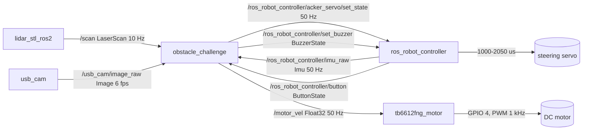
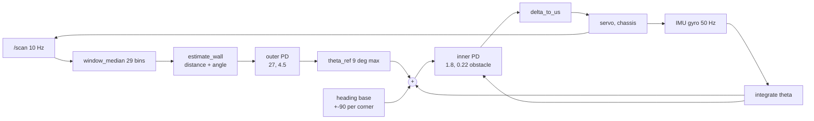
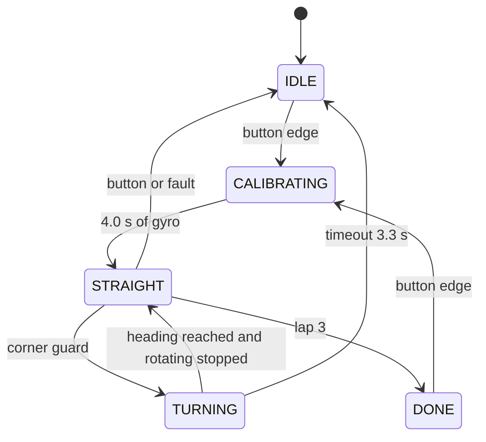
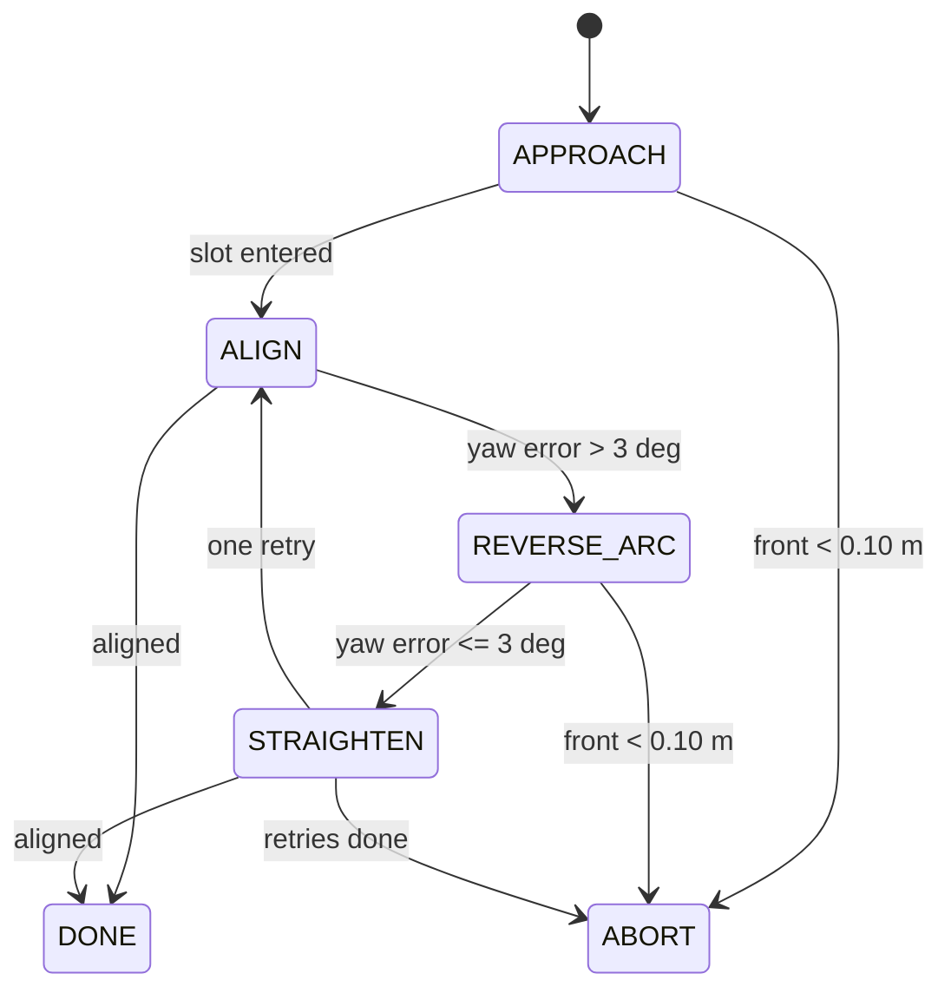

# 03 Software Architecture and Obstacle Strategy

Software for both WRO Future Engineers 2026 challenges: node graph, cascade control and why it is a
PD and not a PID, the LiDAR and camera chains, the state machines, parallel parking, edge cases, and
the test and tuning process with the metrics used to judge a run.

The car runs two packages, `src/renkay_open/renkay_open` (`open_challenge`) and
`src/renkay_obstacle/renkay_obstacle` (`obstacle_challenge`), each with one entry point
`robot_node.py`. Path shorthand: `open/config.py` is `src/renkay_open/renkay_open/config.py`,
`obstacle/config.py` is `src/renkay_obstacle/renkay_obstacle/config.py`. Every constant is cited at
`file:line`. The strategy those modules implement, section by section on the field, is in
[04 Obstacle Strategy](04-obstacle-strategy.md).

## 1. Processes, nodes and modules

Three laps then stop (rules 9.24.4), 3 minute round (rules 12), red pillar passed on the right and
green on the left (rules 9.19), then park in the lot (rules 5). Processing is on board a Pi 5 in
Python, so the control period is set by the 50 Hz IMU, not by a real-time kernel.

Five ROS 2 nodes run at once. Ours are `obstacle_challenge` (or `open_challenge`) in
`robot_node.py`, which reads every sensor and writes servo and motor, and `tb6612fng_motor` in
`motor_driver.py`, which turns duty into PWM on the TB6612FNG through `lgpio` (gpiochip 4, PWM A 12,
AIN1 5, AIN2 6, STBY 13) and has its own 0.30 s watchdog (`motor_driver.py:31`). The other three come
from the sensor stack: `lidar_stl_ros2` (`/scan`), `usb_cam` (`/usb_cam/image_raw`) and the
`ros_robot_controller` firmware, which is the servo, IMU, button and buzzer backend only, never the
motor backend. `config.py`, `control.py` and `color_vision.py` are plain modules: no `rclpy`, no
topic, so every filter and control law is testable on a laptop with synthetic data. Neither challenge
node reads ROS parameters: `config.py` is the single source of truth and `config/*.yaml` holds
reference values only. The motor driver is the one exception, with its GPIO and watchdog values
declared as node parameters that repeat the same defaults (`motor_driver.py:25-37`).



Publishers and subscriptions are `robot_node.py:48-60` and `open/robot_node.py:44-54`; the 50 ms
watchdog timer is `robot_node.py:81`. Two things differ from the older documentation. There is no
camera node: vision runs inside the controller (`robot_node.py:163-190`) and the `/obstaculos` topic
does not exist. There is no servo node: the RRC firmware owns the output and receives microseconds
with a 60 ms move duration (`config.py:25`). The default single-threaded executor means a slow image
callback delays `/scan` and `/imu_raw`; section 9 assumes a frame under 40 ms, and the mitigation is
a `MultiThreadedExecutor` with the image subscription in its own callback group.

## 2. Control architecture

The outer loop turns geometry into a heading request at 10 Hz; the inner loop turns heading error
into steering at 50 Hz. Only the inner loop writes to the servo.



Signals: `distance_m` is the perpendicular distance to the followed wall, 0.12 to 0.90 m
(`control.py:113-115`); `theta_ref` is the heading request, +-9 deg (`open/config.py:23`);
`theta_deg` is the heading integrated since calibration (`control.py:59-63`); `delta` is the
steering command, +-30 deg (`config.py:16`), sent as 1000 to 2050 us (`config.py:20-21`). The
sensors fail in opposite ways: the LiDAR measures absolute position but only at 10 Hz with dropouts,
the gyro is smooth at 50 Hz but drifts 0.006 rad/s (`data/measurements.csv:42`), 0.34 deg/s or 8.6
deg per 25 s lap. The cascade uses each for what it is good at, and the inner loop rejects a LiDAR
dropout before it reaches the servo.

**PD, not PID.**

1. The plant already has the integrator: lateral position is the integral of heading, heading the
   integral of yaw rate, so the outer P term is already an integrator in the position loop. An I term
   puts two poles at the origin, 180 deg of low frequency lag and a slow oscillation.
2. The outer loop removes the steady state error. The inner loop tracks a heading that is re-issued
   continuously; a constant inner offset becomes a heading bias, the outer loop reads it as a
   distance error and corrects it.
3. No windup at corner entry. The outer loop is frozen during a turn (`robot_node.py:204-205`,
   `open/robot_node.py:219-220`), so a 1.5 s turn would accumulate the pre-turn error and release it
   as a steering offset on exit, in a 1000 mm corridor.
4. Saturation is harmless: the command clamps at +-30 deg (`config.py:16`) and the linkage reaches
   only 19.7 deg left and 17.6 deg right at a 25 deg command (`data/measurements.csv:15-16`), so the
   clamp is active in every tight turn. A PD recovers; a PID would wind up.

The derivative acts on the gyro, not on the error: `d = KP_IN * err - KD_IN * gz`
(`control.py:67`), so the 90 deg reference step at a corner cannot spike the servo.

| Gain | Obstacle | Open | Units | Meaning |
|---|---|---|---|---|
| `KP_IN` | 1.8 (`obstacle/config.py:14`) | 1.6 (`open/config.py:15`) | deg/deg | heading error to steering |
| `KD_IN` | 0.22 (`obstacle/config.py:15`) | 0.28 (`open/config.py:16`) | s | lead time on yaw rate |
| `KP_OUT` | 27 (`open/config.py:20`) | 27 | deg/m | lateral error to heading |
| `KD_OUT` | 4.5 (`open/config.py:21`) | 4.5 | deg/(m/s) | damping of the lateral error rate |

Three numbers bound the values. At 0.39 m/s with a 117.4 mm wheelbase one degree of road wheel gives
3.3 deg/s of yaw, so `KP_IN = 1.8` is a 5.98 1/s loop, a 167 ms time constant. The 60 ms servo delay
(`data/measurements.csv:19`) costs 21 deg at a 6 rad/s crossover on top of the integrator's 90 deg:
about 69 deg of phase margin, which is why the stiffer obstacle set does not oscillate. On the outer
loop `1/(v*KP_OUT)` is 5.4 s at 0.39 m/s, 2.1 m of travel for a 0.1 m offset, slower than one
straight so a correction cannot overshoot into the next corner. The pairs are track specific: the
obstacle car follows a 0.18 m wall where a 10 deg heading error moves the side ray by 43 mm and needs
the stiffer loop, the open car centres in the corridor and can afford more lead. The sweep that
should confirm the pair is in section 8; no row is logged yet.

## 3. LiDAR processing

The driver's zero is not the robot's front, and the old index `center_deg / 360 * n`
(`control.py:22-23`) only holds for a full 360 deg scan. The real scan is 306 bins over 220 deg,
+-110 deg about the front. The fix derives the mapping from the message:

```
increment_deg = degrees(msg.angle_increment)
index(theta)  = round((theta - degrees(msg.angle_min)) / increment_deg) mod N
half          = round(LIDAR_WINDOW_HALF_DEG / increment_deg)
```

| Quantity | Value | Derivation |
|---|---|---|
| bins `N` | 306 | 220 / 0.7213 + 1 |
| `angle_increment` | 0.7213 deg | 220 / 305 |
| `angle_min` | 70 deg | 180 front minus 110 |
| front bin (180 deg) | 152 | (180 - 70) / 0.7213 |
| window +-10 deg | 29 bins | 2 * round(10 / 0.7213) + 1 |

One bin is 2.3 mm of arc at the 0.18 m target, so a 20 deg window averages the ranging noise without
turning a corner into a ramp.

**Median instead of mean** (`control.py:16-32`). With 24 rays on the wall at 0.18 m and 5 on a pillar
at 0.40 m the mean is `(24*0.18 + 5*0.40)/29 = 0.218 m`, a +38 mm error, 21 percent of the target,
while the median stays 0.180 m. Non-finite returns and values outside 0.12 to 3.3 m are discarded
before the sort (`control.py:27`), so the median is never taken over a hole, and an all-invalid window
returns `None` so the caller holds the previous request rather than inventing one. A median tolerates
14 of 29 corrupted samples, a mean is moved by one. The cost is a 29 float sort every 100 ms and no
added latency, because the filter runs inside one scan.

**Self returns.** Below 0.12 m the scan sees the car: rear rays hit the chassis at 2 to 8 cm, and
`LIDAR_MIN_M = 0.05` (`config.py:36`) is under that, so the floor rises to 0.12 m. At the 0.18 m
target the 60 deg ray travels `0.18/sin(60) = 0.208 m` and the 30 deg ray 0.360 m, both clear of the
floor; at a 0.10 m target the 60 deg ray would be 0.115 m and the wall fit would lose one of its two
points. That is the quantitative reason for 0.18 m.

**Wall fit and pillar rejection.** `estimate_wall` (`control.py:88-116`) builds the segment between
the two median hits, orients it forward, and returns perpendicular distance and segment angle,
rejecting a segment under 30 mm, an angle beyond 55 deg (`config.py:43`) or a distance outside 0.12
to 0.90 m (`config.py:44`). A 50 mm pillar is not a wall, so the fix adds a distance consistency
gate: a plane parallel to the chassis must satisfy `forward/side = sin(60)/sin(30) = 1.732`, and both
beams can only hit one pillar if it subtends 30 deg, `2*atan(25/r) >= 30 deg`, or `r <= 93 mm`.

**Following law.** `wall_follow_offset` (`control.py:119-129`) sums the wall angle with
`atan(1.5 * (d - 0.18))`, clamped to +-7 deg (`config.py:46`). The arctangent keeps a large error from
saturating the servo: at 0.4 m a linear term asks 34 deg, `atan` asks 12.4. The open car instead
projects both side ranges onto the wall normal (`open/control.py:92-96`), which removes a 43 mm false
lateral error caused by a 10 deg heading error at a 0.18 m wall.

## 4. Vision

The camera is fixed, forward, upside down, 66.7 deg HFOV measured (`data/measurements.csv:38`). The
frame is used as captured: no undistort, no crop, no rotation.

| Stage | Operation | Parameter | Citation |
|---|---|---|---|
| 1 | blur 5x5, BGR to HSV | 5x5 | `color_vision.py:54` |
| 2 | red mask, two hue ranges | H 0-13 and 169-180, S>=80, V>=50 | `config.py:55-60` |
| 3 | green mask | H 53-89, S>=25, V>=25 | `config.py:61-64` |
| 4 | open then close | 7x7, 2 iterations | `config.py:68-69` |
| 5 | area, fill, aspect filters | 650 px, 0.42, 2.6 | `config.py:65-67` |
| 6 | nearest block = largest `base_norm` | - | `color_vision.py:59` |
| 7 | 3 frame confirm, 1.5 s expiry | 3 frames, 1.5 s | `config.py:52` |

HSV rather than RGB because venue lighting changes between practice and rounds while hue does not;
red wraps at 180, hence two ranges (`color_vision.py:10-15`). Area removes noise, fill removes
scattered reflections (a solid 50 x 100 mm pillar fills its box, a glare patch does not), and aspect
removes the 20 mm orange and blue track lines (rules 13.9), ratio 10 or more against 2 for a pillar.

**Known limitation: the image is mirrored.** Because the frame is processed as captured by an
inverted camera, `cx_norm` runs opposite to the car's lateral axis. The sign inside `pillar_nudge_deg`
(`-cx_norm`, `control.py:143`) carries the measured behaviour; it is a property of this mount, not of
the geometry, so it has to be re-validated whenever the camera is re-mounted and cannot be copied to
a second car without checking.

The 650 px threshold is a range gate: on a 640 x 480 frame, 66.7 deg over 640 px gives 0.104 deg per
pixel, a 50 mm pillar at 0.5 m is 55 x 104 px and 5 700 px of box, and area falls with range squared,
so 650 px is the same pillar at roughly 1.5 m. Three frames at 6 fps is 500 ms of agreement, 195 mm of
travel; a wrong side loses the round, a late commit costs nothing because the decision persists. The
block expires 1.5 s (9 frames) after the last detection, 0.58 m of travel: long enough that one
dropped frame does not cancel the nudge, short enough that a stale nudge cannot reach the next
corner.

## 5. State machines



The obstacle machine is the same with `FOLLOWING` and `TURNING`, plus `PARKING` between the twelfth
corner and `DONE`.

| State | Entry | Exit | Guard | Timeout | Output |
|---|---|---|---|---|---|
| `IDLE` | power on, `stop()`, reset | button | state 1 or 5, 1.5 s debounce (`robot_node.py:113-124`) | none | 0 %, centre |
| `CALIBRATING` | button | 4.0 s | mean gyro becomes the bias (`robot_node.py:134-145`) | 4.0 s | 0 %, centre |
| `STRAIGHT` / `FOLLOWING` | calibration, turn done | corner, lap 3, lap 12 | `detect_corner` (`open/control.py:133-143`) | none | 75 % open, 35 % obstacle |
| `TURNING` | corner | heading reached | `turn_complete` | 3.3 s (`config.py:78`) | 42 % open, 35 % obstacle |
| `PARKING` | corner 12 | parked or abort | section 6 | 20 s per state | 0 to 25 %, signed |
| `DONE` | lap 3, parked | button | `MAX_LAPS = 3` (`config.py:86`) | none | 0 %, two beeps |

The corner guard is four conditions in series: front closer than the threshold, no turn in the last
1.5 s, heading within 15 deg of the straight (obstacle) or 10 deg (open), and one side seeing more
than 1.20 m (obstacle, `config.py:79`) or 1.80 m (open, `open/config.py:59`). Obstacle uses 0.65 m of
front clearance (`config.py:73`) against 0.80 m open (`open/config.py:53`) because its corridor is
1000 mm (rules 8a), so a 1.20 m free side can only be an opening. At 0.39 m/s the 0.65 m threshold is
1.67 s and a 90 deg arc at the 0.37 m minimum radius is 0.581 m, 1.49 s: the warning is just longer
than the manoeuvre.

## 6. Parallel parking

New in this branch: `parking.py`, six states driven by the side LiDAR distance and the integrated
heading. The 2026 rules require it (rules 5, Appendix A.6); the previous code stopped after lap 3.



| State | Entry | Action | Exit |
|---|---|---|---|
| `APPROACH` | lap 12 | follow the wall, duty 25 %, watch the marker step | slot entered, heading within 10 deg |
| `ALIGN` | slot entered, stopped | two side readings one wheelbase apart give distance and yaw | aligned, or reverse needed |
| `REVERSE_ARC` | yaw error > 3 deg | reverse, opposite lock, negative duty | yaw error <= 3 deg, or rear clearance < 0.10 m |
| `STRAIGHTEN` | arc done | forward, counter lock | aligned, or retry once |
| `DONE` | acceptance met | 0 %, two beeps | - |
| `ABORT` | guard failed | 0 %, one long beep | terminal |

The lot is 200 mm wide and `1.5 * 189 = 283.5 mm` long (rules 5: width 20 cm, length 1.5 times the
robot; chassis 189 mm, `data/measurements.csv:9`). With a 133.5 mm front track
(`data/measurements.csv:7`) the centre line can sit between 66.75 and 133.25 mm from the wall: a
66.5 mm window, and the reason the parking tolerance is measured in the same units as the wheels.
The bay side is selected by `PARK_STEER_SIGN` (default -1.0), a field calibrated constant: which sign
puts the car into the lot depends on the side the lot is on and on the servo direction, so it is set
by driving the manoeuvre once on the field, not derived. Minimum turning radius from the measured
17.6 deg road wheel at a 25 deg command is 370 mm (`data/measurements.csv:17`), longer than the lot,
so the car arrives almost aligned and corrects a residual. A heading change `theta` at that radius
shifts the car by `R*(1-cos theta)`, 1.1 mm per degree near zero, so `ALIGN` corrects lateral
distance first and yaw second, iterating.

Acceptance comes from the rule: fully inside and the two wheel to wall distances within 20 mm
(rules Appendix A.6). Two readings one wheelbase apart map yaw onto that difference as `L*sin(psi)`,
so 20 mm over 117.4 mm is 9.8 deg. The target is `|yaw| <= 5 deg`, a 10.2 mm wheel difference, half
the legal limit, and `|lateral error| <= 20 mm`, recorded per run as `final_lateral_error_mm` and
`final_yaw_deg`. The 0.10 m abort threshold follows from motion: reverse at 25 percent is
`0.0137*(25-6.5) = 0.25 m/s` (`data/measurements.csv:20-21`) and stops in `0.25^2/(2*0.6) = 52 mm`
at the 0.6 m/s^2 limit (`data/measurements.csv:25`), leaving 48 mm.

PARK_TARGET_GAP_M is 0.03 m. The 200 mm lot less the 133.5 mm track leaves 33.25 mm per side, so
30 mm is the largest lateral target that still fits, with 3 mm of margin. A 0.15 m standoff would
put the outer wheel 16.8 mm outside the lot, which is why the constant is not 0.15.

## 7. Edge cases

| Case | Detection | Action | Test |
|---|---|---|---|
| LiDAR missing | no `/scan` for 0.35 s (`config.py:94`) | motor 0, centre, fault latched against the IMU callback | unplug it, it must stay stopped until the button |
| IMU missing | no `/imu_raw` for 0.20 s (`config.py:93`) | same latch, heading unknown | `ros2 topic hz` without the IMU |
| Camera block | no frame or no detection for 1.5 s | nudge decays to 0, keep the committed side | cover the lens mid-straight |
| Wall side flip | colour confirmed, never while turning (`robot_node.py:184`) | re-anchor heading base, zero `theta_ref` | green after red, no heading jump |
| Pillar as wall | angle > 55 deg or the 1.732 ratio broken | reject the pair, hold one scan | 5 pillar rays among 24 wall rays |
| Corner timeout | turning beyond 3.3 s | motor 0, centre, `IDLE` (`robot_node.py:270-272`) | hold the car in a turn |
| Start crossing | lap 3 ends before the lot | parking starts at the lot entry, no extra lap | start inside the lot, log the counter |
| Lap miscount | count not 4 per lap, or a 30 deg yaw jump | reject the event, keep the count, log it | rotate the car by hand mid-turn |
| Watchdog | fault latched once | stopped until an explicit reset, the 50 Hz IMU write is gated | kill the scan publisher mid-run |

Lap counting moved from integrated yaw (`control.py:218-230`) to corner events. A 0.34 deg/s bias
drifts 8.6 deg per lap, so a counter built on absolute yaw fires one corner early or late, and it
counts up on `abs(theta)` even when the car is pushed backwards. `LAP_MARGIN_DEG` (`config.py:87`)
was the tolerance of that counter and is unused after this change.

## 8. Testing and tuning

Unit tests run on the pure modules only, no ROS, under a second: median with 5 pillar rays returns the
wall; an all-invalid window returns `None`; the 306 bin mapping puts 180 deg in bin 152; a parallel
wall at 0.18 m returns 0.18 +- 3 mm and 0 +- 1 deg; two rays on a 50 mm pillar are rejected; a closed
corridor is not a corner; four corner events give one lap and a timeout none; +30 and -30 deg map to
2050 and 1000 us; 5 deg of yaw gives 10.2 mm of wheel difference.

Each lab run starts in the zone, presses the button, and logs `/scan`, `/imu_raw`, commands and state
transitions with timestamps; the metrics come from the log, not from watching the car.

| Metric | Definition | Target |
|---|---|---|
| Lap time | corner event 4k to 4k+4 | <= 25 s |
| Lap consistency | max minus min over 3 laps | <= 2 s |
| Mean lateral error | RMS of `distance - 0.18` on straights | <= 20 mm |
| Max lateral error | peak outside corners | <= 50 mm |
| False corners | events that did not complete 90 deg | 0 |
| Colour false positives | wrong side commits per 100 frames | <= 1 |
| Parking | fully inside and parallel | pass on first attempt |

Gain experiment: one factor at a time, three runs per point, same voltage band and start position.
`KP_IN` 1.2 to 2.4 step 0.3 at `KD_IN = 0.22`, metric is peak yaw beyond the base after a corner,
reject any second peak. Then `KD_IN` 0.14 to 0.34 step 0.04 against settling to +-2 deg, optimum
expected near 0.22 s because that is 3.7 servo delays. Then `KP_OUT` 18 to 36 step 6 against steering
reversals per metre, then `KD_OUT` 2.0 to 7.0 step 1.5 against peak error after a nudge. A point is
accepted only if all three runs pass; rows go to `data/test-runs.csv` with the commit hash. No run of
the current code is logged yet: the file has a header and no rows, so every target in the table above
is a target, not a measurement.

## 9. Performance budget

| Path | Sensor period | Sensor age | Compute | Actuation | End to end | Travel at 0.39 m/s |
|---|---|---|---|---|---|---|
| LiDAR to servo | 100 ms | 100 ms | < 5 ms | 60 ms | 165 ms | 64 mm |
| IMU to servo | 20 ms | 20 ms | < 2 ms | 60 ms | 82 ms | 32 mm |
| Camera to decision | 167 ms | 167 ms | ~30 ms | 0 | 197 ms | 77 mm |
| Camera, 3 frame confirm | 167 ms | 500 ms | ~30 ms | 0 | 530 ms | 207 mm |

Rates are measured: LiDAR 10 Hz (`config.py:92`), camera 6 fps (`data/measurements.csv:39`), IMU
50 Hz (`data/measurements.csv:40`), control period 20 ms, servo 60 ms (`config.py:25`). The slowest
reactive path is 165 ms, 64 mm of travel, shorter than the 113 mm clearance to the followed wall, so
one missed scan does not become a contact.
