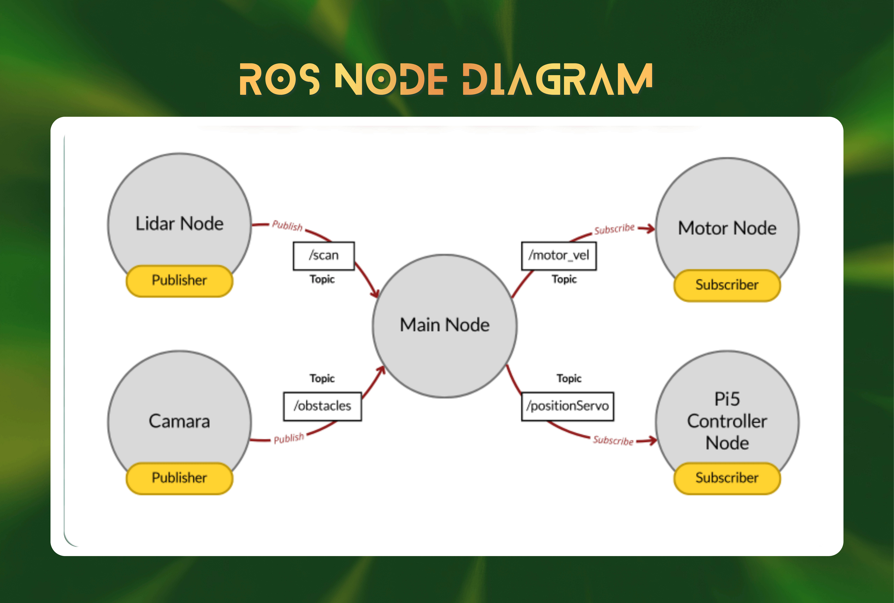
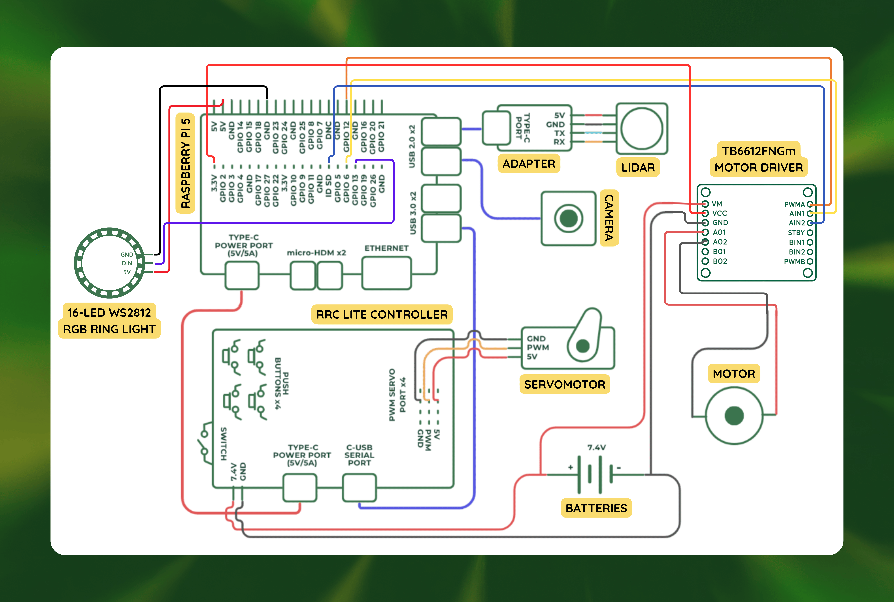
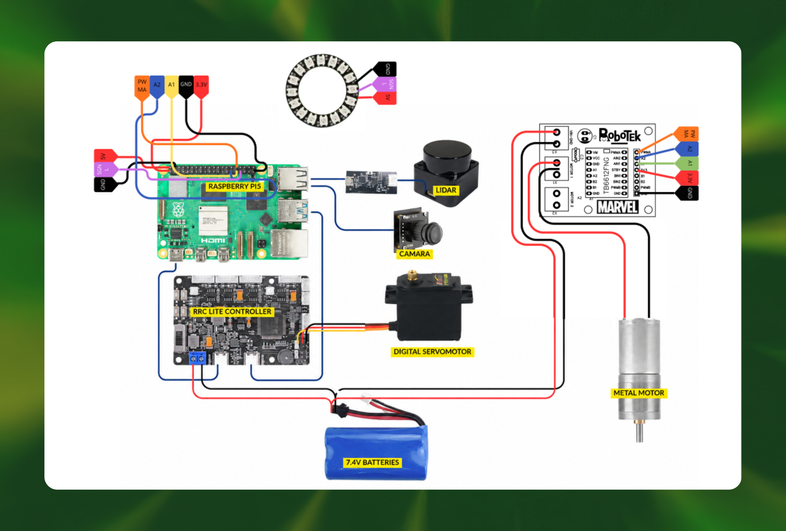
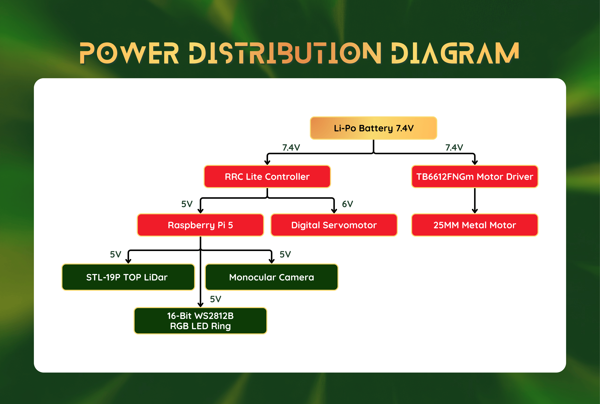
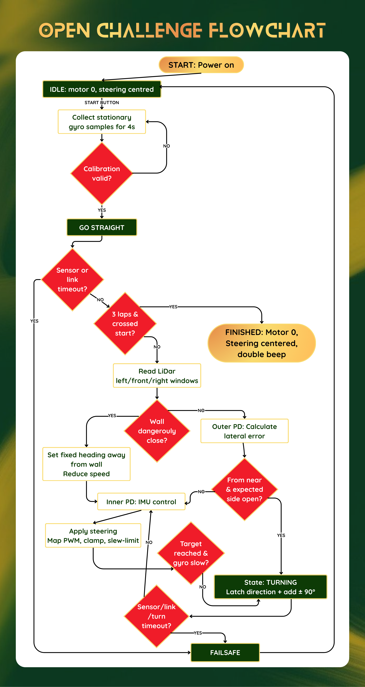
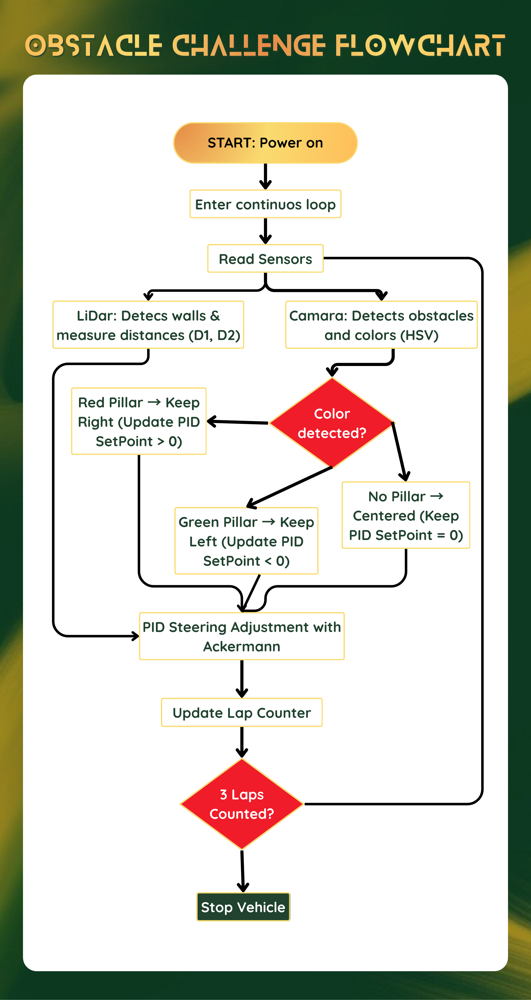

# Media and Diagrams

This page indexes every diagram, photograph and video in the repository. Each asset is stored locally; nothing is loaded from a third-party account.

## 1. Diagrams

All diagrams are exported at full resolution from the original source. They describe the v11 vehicle.

### 1.1 ROS node graph

Nodes, topics and message directions between the Raspberry Pi 5, the RRC Lite controller, the LD19 LiDAR, the camera and the IMU. The same graph is described as a table in [Software Architecture](03-software-architecture.md#2-node-graph).

### 1.2 Electrical wiring

Point-to-point wiring between the battery, the fuse, the RRC Lite, the TB6612FNG driver, the servo, the LiDAR and the Raspberry Pi 5. Pin numbers match the GPIO table in [Power and Sensors](02-power-and-sensors.md#4-gpio-and-bus-map).

### 1.3 Visual wiring

Physical routing of the same connections, used during assembly. Wire colours follow the convention in the assembly section.

### 1.4 Power distribution

Two-rail topology: 7.4 V for the motors and 5 V for the compute and sensor rail. This diagram replaces the 6 V UBEC version used up to v10.

### 1.5 Open Challenge flowchart

Behaviour of the Open Challenge: start crossing, three laps, lane keeping and finish. The state names match the `State` enum in `renkay_open`.

### 1.6 Obstacle Challenge flowchart

Behaviour of the Obstacle Challenge: colour detection, side selection, pillar avoidance, return to lane, lap counting and parallel parking. The state names match the `State` enum in `renkay_obstacle`.

## 2. Photographs

### 2.1 Team

| File | Content |
|---|---|
| [`t-photos/official-team-photo.jpg`](../t-photos/official-team-photo.jpg) | Official team photograph, all three members and the coach |
| [`t-photos/funny-photo.jpg`](../t-photos/funny-photo.jpg) | Team photograph for the presentation |

### 2.2 Vehicle, real

| File | View |
|---|---|
| [`v-photos/real-vehicle/vehicle-front.png`](../v-photos/real-vehicle/vehicle-front.png) | Front |
| [`v-photos/real-vehicle/vehicle-back.png`](../v-photos/real-vehicle/vehicle-back.png) | Back |
| [`v-photos/real-vehicle/vehicle-left.png`](../v-photos/real-vehicle/vehicle-left.png) | Left |
| [`v-photos/real-vehicle/vehicle-right.png`](../v-photos/real-vehicle/vehicle-right.png) | Right |
| [`v-photos/real-vehicle/vehicle-top.png`](../v-photos/real-vehicle/vehicle-top.png) | Top |
| [`v-photos/real-vehicle/vehicle-bottom.png`](../v-photos/real-vehicle/vehicle-bottom.png) | Bottom |

### 2.3 Vehicle, 3D model

| File | View |
|---|---|
| [`v-photos/3d-vehicle/vehicle_3d_front.png`](../v-photos/3d-vehicle/vehicle_3d_front.png) | Front |
| [`v-photos/3d-vehicle/vehicle_3d_back.png`](../v-photos/3d-vehicle/vehicle_3d_back.png) | Back |
| [`v-photos/3d-vehicle/vehicle_3d_left.png`](../v-photos/3d-vehicle/vehicle_3d_left.png) | Left |
| [`v-photos/3d-vehicle/vehicle_3d_right.png`](../v-photos/3d-vehicle/vehicle_3d_right.png) | Right |
| [`v-photos/3d-vehicle/vehicle_3d_top.png`](../v-photos/3d-vehicle/vehicle_3d_top.png) | Top |
| [`v-photos/3d-vehicle/vehicle_3d_bottom.png`](../v-photos/3d-vehicle/vehicle_3d_bottom.png) | Bottom |

The renders show the printed and laser-cut parts only. Motors, wheels, battery and camera are documented in the assembly sequence.

## 3. Videos

| Challenge | Link | Status |
|---|---|---|
| Open Challenge | https://youtu.be/lE8SPT6_tL0 | Published, autonomous run |
| Obstacle Challenge | pending | To be recorded with three laps and the parking manoeuvre |

Both videos must show at least 30 seconds of autonomous driving, one per challenge, as required by the 2026 rules.

## 4. Capture protocol for missing material

The following shots are still missing and are listed here so they are not forgotten:

1. Obstacle Challenge run with three complete laps and the parallel parking manoeuvre, camera fixed, no cuts.
2. Parking manoeuvre in both directions, three consecutive successful attempts.
3. Recovery demonstration: LiDAR disconnected, IMU drift injected, camera covered.
4. Tuning session with the serial log visible.
5. Printed base plate and the laser-cut MDF plate side by side.
6. The measurement instruments in use: caliper on the wheel, scale under the vehicle, multimeter on each rail.
